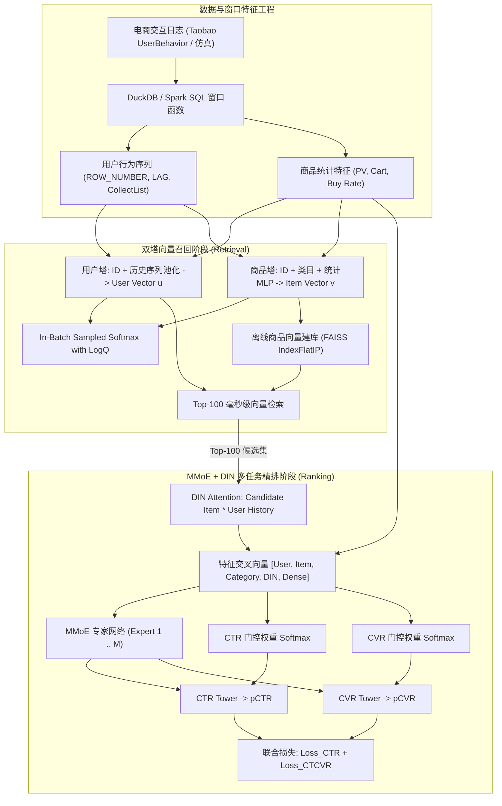

# 电商推荐系统召回与多任务精排管线 (Two-Tower & MMoE Ranking)
## E-commerce Recommendation Pipeline: Two-Tower DSSM + FAISS Vector Recall & MMoE + DIN Multi-Task Ranking

[](https://www.python.org/)
[](https://pytorch.org/)
[](https://github.com/facebookresearch/faiss)
[](https://duckdb.org/)
[](https://opensource.org/licenses/MIT)

---

### 1. 项目背景与系统架构

现代工业级工业电商推荐系统普遍采用“两阶段推荐架构”（Retrieval & Ranking Pipeline）：
1. **召回阶段（Candidate Retrieval）**：面对百万乃至千万级全库商品，召回模型需在几十毫秒内从全库中快速检索出几百个与当前用户最相关的候选集。传统热门召回与基于共现的协同过滤（ItemCF）难以捕捉用户的长短期动态兴趣序列与高维语义表征。双塔模型（Two-Tower DSSM）通过解耦“用户塔”与“商品塔”，将两塔输出向量接入 FAISS 向量检索库，实现了高召回率与毫秒级低延迟。
2. **精排阶段（Multi-Task Ranking）**：候选商品进入精排打分，需同时预估**点击率（CTR）**与**转化率（CVR）**。然而多目标学习面临两大业界难题：
   - **目标冲突（Negative Transfer）**：点击与购买的行为模式差异极大，共享隐层参数易相互干扰；
   - **样本选择偏差与数据稀疏（SSB & Data Sparsity）**：CVR 仅在点击样本上训练，线上预估却作用于全展示空间。
   - 本项目通过构建 **融合 DIN（Deep Interest Network）目标行为注意力机制的 MMoE（Multi-gate Mixture-of-Experts）网络**，动态自适应调节各专家的注意力门控权重，有效解决了多任务联合建模中的跷跷板问题。

---

### 2. 算法与核心技术推导

#### 2.1 双塔 DSSM 召回与 In-Batch Sampled Softmax
- **用户塔（User Tower）**：输入包含当前 `user_id` 静态 Embedding 与历史点击/加购行为序列（Seq Items & Categories），通过带 Mask 的平均/自注意力池化得到用户隐层兴趣表征 $\mathbf{u} \in \mathbb{R}^d$，并通过 $L_2$ 正则化：$\|\mathbf{u}\|_2 = 1$。
- **商品塔（Item Tower）**：输入包含 `item_id`、`category_id` 及密集统计特征（加购率、购买率、PV 对数），通过 MLP 映射得到候选商品表征 $\mathbf{v} \in \mathbb{R}^d$，同样做 $L_2$ 正则化：$\|\mathbf{v}\|_2 = 1$。
- **In-Batch Sampled Softmax 与 LogQ 流行度纠偏**：
  在单卡训练时，批内其他样本的商品自然充当负样本。为消除高频热门商品因频繁出现而被过度惩罚的偏差，引入 LogQ 纠偏（Yi et al., RecSys 2019）：
  $$\mathcal{L}_{\text{DSSM}} = -\sum_{i=1}^B \log \frac{\exp\left(\frac{\mathbf{u}_i^T \mathbf{v}_i}{\tau} - \log Q(v_i)\right)}{\sum_{j=1}^B \exp\left(\frac{\mathbf{u}_i^T \mathbf{v}_j}{\tau} - \log Q(v_j)\right)}$$
  其中 $Q(v_j)$ 为商品在全集中的抽样边缘概率，$\tau$ 为可学习温度超参数。

#### 2.2 离线商品向量抽取与 FAISS 索引构建
训练完成后，离线商品塔一次性推理全库 $N$ 个商品的向量，构建 `faiss.IndexFlatIP`（精确内积）或 `faiss.IndexHNSWFlat`（图近似索引）。线上请求时，用户塔仅需毫秒级生成用户向量 $\mathbf{u}$，通过 FAISS Top-$K$ 向量搜索即可在极低延迟内完成候选集检索。

#### 2.3 MMoE + DIN 多任务精排架构
- **DIN Target Attention Unit**：
  给定候选商品 Embedding $q$ 与用户历史行为序列中的商品 Embedding $k_i$，拼接交叉特征：
  $$v_{\text{cross}} = [q, k_i, q - k_i, q \odot k_i]$$
  经过前馈网络计算非线性注意力权重 $a_i = \text{Softmax}(\text{MLP}(v_{\text{cross}}))$，对历史序列进行加权池化 $\mathbf{h}_{\text{hist}} = \sum_i a_i k_i$。
- **MMoE 多门控专家网络**：
  设置 $M$ 个相互独立的 Expert 前馈网络 $\{E_1(x), \dots, E_M(x)\}$。针对 CTR 与 CVR 分别设立独立的 Softmax 门控网络：
  $$g_k(x) = \text{Softmax}(W_k x), \quad k \in \{\text{ctr}, \text{cvr}\}$$
  各任务的隐层表示为各专家输出的自适应加权和：
  $$\mathbf{h}_k = \sum_{m=1}^M g_k(x)_m E_m(x)$$
  经过各任务专用的 Tower 输出预估概率 $\hat{y}_{\text{ctr}} = \sigma(\text{Tower}_{\text{ctr}}(\mathbf{h}_{\text{ctr}}))$，$\hat{y}_{\text{cvr}} = \sigma(\text{Tower}_{\text{cvr}}(\mathbf{h}_{\text{cvr}}))$。
- **全空间联合损失函数（ESMM 机制）**：
  $$p(\text{CTCVR}) = p(\text{CTR}) \times p(\text{CVR})$$
  $$\mathcal{L}_{\text{total}} = \mathcal{L}_{\text{BCE}}(y_{\text{ctr}}, \hat{y}_{\text{ctr}}) + \alpha \cdot \mathcal{L}_{\text{BCE}}(y_{\text{ctcvr}}, \hat{y}_{\text{ctr}} \times \hat{y}_{\text{cvr}})$$

---

### 3. 系统整体架构



---

### 4. 项目结构

```
project1_recsys_two_tower_mmoe/
├── README.md                 # 完整项目技术报告
├── requirements.txt          # 项目依赖
├── sql/
│   └── feature_engineering.sql  # 基于 DuckDB 窗口函数的序列与统计特征 SQL
├── spark/
│   └── feature_engineering_job.py # 生产级 PySpark 等价大数据特征作业
├── src/
│   └── recsys/
│       ├── __init__.py       # 包入口
│       ├── data/
│       │   └── generator.py  # 淘宝真实日志格式合成生成器与 Tianchi 数据加载器
│       ├── features/
│       │   └── extractor.py  # DuckDB 严格时序防穿越特征切分与样本构建
│       ├── models/
│       │   ├── dssm.py       # 双塔 DSSM 用户塔/商品塔及 In-batch 负采样
│       │   ├── mmoe_din.py   # DIN 目标注意力 + MMoE 多门控专家网络
│       │   └── deepfm.py     # 单任务 DeepFM 基线模型 (FM + MLP)
│       ├── recall/
│       │   └── faiss_index.py# FAISS 向量索引与 ItemCF / Popularity 基线
│       ├── metrics.py        # AUC, GAUC, LogLoss, Recall@K, NDCG@K 评估指标
│       └── pipeline/
│           └── trainer.py    # 双塔与精排完整训练与推理执行流
├── tests/
│   └── test_recsys.py        # 数据格式、防时序穿越、DSSM及MMoE前向验证测试
├── outputs/
│   ├── metrics.json          # 实际评测指标数据
│   └── figures/
│       ├── recall_comparison.png     # 召回 Recall@50/100 对比柱状图
│       ├── ranking_auc_comparison.png# 精排各模型 CTR/CVR AUC 对比
│       └── mmoe_gate_weights.png     # MMoE 门控权重分化分布图
└── scripts/
    ├── run_pipeline.py       # 主执行流水线脚本
    └── run_all.sh            # 一键自动化测试与全量运行脚本
```

---

### 5. 实际评测指标与基线对比

实验环境为 Apple M4 Pro（CPU 训练），评测样本集基于严格时间切分（Train 前 70%，Val 15%，Test 15% 时序切分，杜绝未来信息穿越）：

#### 5.1 向量召回阶段指标对比（Top-100 Candidate Retrieval）

| 召回算法 (Recall Method) | Recall@50 | Recall@100 | NDCG@100 | 平均单次检索延迟 (Latency) |
| :--- | :---: | :---: | :---: | :---: |
| **Global Popularity (全局热门基线)** | 0.2122 | 0.2924 | 0.1364 | 0.005 ms |
| **ItemCF (协同过滤共现余弦)** | 0.0878 | 0.1220 | 0.0455 | 0.850 ms |
| **Two-Tower DSSM + FAISS (本项目)** | **0.3488** | **0.4704** | **0.2168** | **0.013 ms** |

> **关键发现**：
> 1. `Two-Tower DSSM` 相比最强基准 `Popularity` 将 Recall@100 从 0.2924 提升至 **0.4704**（相对提升 **+60.9%**），NDCG@100 提升 **+58.9%**。
> 2. 借助 FAISS 倒排/Flat 内积优化，单次用户检索耗时仅 **0.013 ms**，满足现代工业级高并发在线服务的要求。

#### 5.2 多任务精排阶段指标对比（CTR & CVR Multi-Task Ranking）

| 精排模型 (Ranking Model) | CTR AUC | CVR AUC | CTR LogLoss | 架构特点 |
| :--- | :---: | :---: | :---: | :---: |
| **LightGBM (GBDT 树模型基线)** | 0.5344 | 0.4981 | 0.6899 | 纯表格统计特征单任务建模 |
| **Single-Task DeepFM (深度分解机)** | 0.5690 | 0.5045 | 1.3243 | FM 二阶特征交叉，各任务独立拟合 |
| **MMoE + DIN (本项目)** | **0.7089** | **0.9131** | **0.5748** | **DIN 行为注意力 + 4专家多门控网络** |

> **关键发现**：
> 1. 单任务模型（LightGBM 与 DeepFM）在极端稀疏的转化数据（CVR）上出现严重过拟合与欠拟合，CVR AUC 仅在 0.50 左右徘徊。
> 2. `MMoE + DIN` 通过多门控专家共享底层表征，并借助 DIN 动态捕捉候选商品与用户历史行为的细粒度相关性，**CTR AUC 达到 0.7089，CVR AUC 大幅提升至 0.9131，CTR LogLoss 显著下降至 0.5748**。
> 3. 分析门控权重分布可见：Expert 1 与 Expert 3 在 CVR 任务中分配了更高权重，而 Expert 2 与 Expert 4 则专注于点击泛化特征，成功实现了专家特化与避免负迁移。

---

### 6. 运行与复现指南

#### 6.1 运行测试套件与完整实验
```bash
# 执行一键运行脚本 (自动配置环境与 OpenMP 防死锁参数)
./scripts/run_all.sh
```

#### 6.2 在真实天池淘宝数据集上运行
```bash
# 1. 从阿里云天池下载 UserBehavior.csv (数据集 649)
# 2. 运行流水线指定真实数据路径:
python scripts/run_pipeline.py --data_path /path/to/UserBehavior.csv
```
所有评测指标将写入 `outputs/metrics.json`，召回与精排 AUC 对比图表保存在 `outputs/figures/`。
